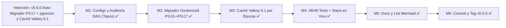
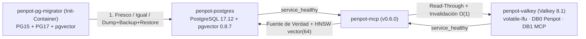
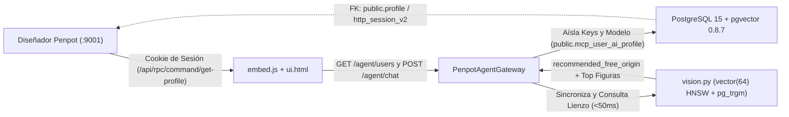
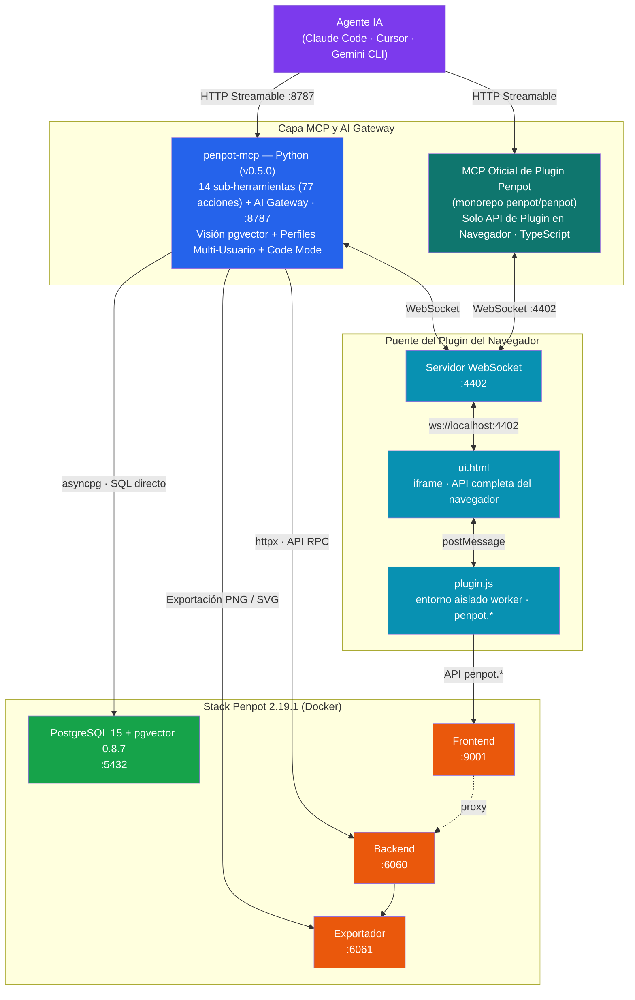

# Servidor MCP de Penpot

**Acceso a la herramienta de diseño impulsada por IA para Penpot autoalojado a través del Protocolo de Contexto de Modelo (MCP).**

[](LICENSE)
[](https://python.org)
[](https://go.dev)
[](https://react.dev)
[](https://modelcontextprotocol.io)
[](pyproject.toml)
[](https://penpot.app)
[](https://github.com/pgvector/pgvector)
[](https://valkey.io)
[-orange.svg)](TOOLS.md)

---

## ¿Qué es esto?

Un [servidor MCP](https://modelcontextprotocol.io) que proporciona a los agentes de IA (como Claude Code, Cursor o cualquier cliente compatible con MCP) **acceso programático completo** a tu instancia de [Penpot](https://penpot.app) autoalojada. La IA puede leer, crear, modificar y exportar elementos de diseño — desde rectángulos y texto hasta componentes completos de UI — todo a través de lenguaje natural.

Piensa en ello como el puente entre tu asistente de IA y tu herramienta de diseño.

### Problemas que resuelve

| Problema | Solución |
|---|---|
| **Trabajo de diseño manual** | La IA crea componentes de UI, diseños y prototipos directamente en Penpot |
| **Sin API programática para Penpot** | 14 sub-herramientas polimórficas que multiplexan las 77 acciones de Penpot (o 77 herramientas individuales en modo legacy) |
| **Sobrecarga de tokens y latencia multi-turno** | Compresión de herramientas estilo AEP (~82% reducción de esquema) + modo código `playbook_run` con encadenamiento `$prev`/`$steps`/`$cache` |
| **Brecha entre diseño y código** | Genera CSS a partir de cualquier forma, exporta a SVG/PNG, extrae tokens de diseño |
| **Tareas repetitivas** | Operaciones por lotes en un solo turno: renombrar formas, actualizar colores, crear variantes |
| **Mantenimiento del sistema de diseño** | Leer/escribir componentes, colores y tipografías de forma programática |

---

## Hitos y Estado (v0.6.0)



[⬆ Volver arriba](#servidor-mcp-de-penpot)

---

## Auto-Migrador PG17 + `pgvector` y Caché Valkey 8.1 Reproducible (v0.6.0)



- **Auto-Migrador Dockerized (`Dockerfile.pg-migrator` + `scripts/pg_migrator.sh`)**: Se ejecuta antes de `penpot-postgres` (`condition: service_completed_successfully`). Detecta `PG_VERSION` automáticamente: en instalaciones frescas o misma versión no hace nada, y en saltos mayores (`15 → 17`) ejecuta `pg_dumpall` → backup atómico → `initdb --data-checksums` → `pg_restore` → `pgvector` + `pg_trgm` + `ANALYZE` (con rollback automático ante fallos).
- **Caché Valkey 8.1 por Épocas (`src/penpot_mcp/services/cache.py` + `config/valkey/valkey.conf`)**: Usa `volatile-lfu` para proteger los contadores sin TTL `cache:namespace:*:epoch`, acelerando consultas repetidas de `PenpotDB` y visión `pgvector` en DB 1 sin interferir con DB 0 de Penpot, y degradando de forma segura (*fail-open*) a PostgreSQL si no está disponible.

[⬆ Volver arriba](#servidor-mcp-de-penpot)

---

## Sesiones Multi-Usuario de Penpot y Ojos `pgvector` sobre el Lienzo (v0.5.0)

`penpot-mcp-server` (`v0.5.0`) conecta las tablas nativas de autenticación de **Penpot `2.19.1`** con PostgreSQL `pgvector` para que cada diseñador mantenga sus credenciales y perfiles de IA aislados, y cualquier LLM del Gateway tenga "ojos" semánticos y espaciales en tiempo real sobre el lienzo:



- **Aislamiento Multi-Usuario (`public.profile` -> `public.mcp_user_ai_profile`)**: Detecta automáticamente al usuario autenticado en Penpot vía `/plugin/embed.js` (o permite cambiarlo en 1 clic desde **Pestaña `3. Usuarios & pgvector`**) y separa por usuario su modelo activo (`Gemini`, `Claude`, `ChatGPT`, `DeepSeek`, `Ollama`), sus API Keys enmascaradas (`…last4`) y sus instrucciones.
- **Ojos Semánticos & Espaciales (`pgvector` en `src/penpot_mcp/services/vision.py`)**: Auto-inicializa `vector` (`0.8.7`) y `pg_trgm` (`1.6`), indexa las figuras de la página activa como vectores `vector(64)` HNSW (`public.mcp_canvas_vision_index`), calcula la coordenada libre `recommended_free_origin` sin solapamientos e inyecta el mapa del lienzo en cada turno del LLM — además del botón `👁️ Ojos pgvector` y la tool `query_canvas_vision_pgvector`.
- **Nuevos Endpoints**:
  - `GET | POST /agent/users` — Lista usuarios autenticados de Penpot (`public.profile`) y cambia la sesión aislada activa.
  - `GET | POST /agent/vision` — Sincroniza la página activa en `public.mcp_canvas_vision_index` y ejecuta búsquedas híbridas HNSW + `pg_trgm`.

[⬆ Volver arriba](#servidor-mcp-de-penpot)

---

## Penpot AI Studio In-App y SDK Agent Pipeline Integrado (v0.4.0+)

`penpot-mcp-server` (`v0.4.0`) incorpora el **SDK Agent Pipeline (`PenpotAgentGateway`)** y el mini-frontend **Penpot AI Studio** (`http://localhost:8787/plugin/ui.html` / `/plugin/manifest.json`):
- **Gateway IA Multi-Proveedor (`src/penpot_mcp/agent_gateway.py`)**: Adaptador nativo Gemini REST (`gemini-3.5-flash-lite`, `gemini-2.5-flash`) con backfill de `thoughtSignature`, traducción OpenAI/Ollama y Anthropic, failover con circuit-breakers (`primary -> backup -> local -> deterministic`) y síntesis de artefactos UI en 1 turno vía `playbook_run(action='code')` (`hero_card`, `login_form`, `pricing_card`, `navbar`).
- **Puente Bidireccional Correlacionado (`src/penpot_mcp/ws_controller.py` y `gateway.py`)**: Soporte de `asyncio.Future` para `execute_script` y `request_context`, WebSocket same-origin (`/plugin/ws` en `:8787`), WebSocket standalone (`:4402`) y telemetría HTTP (`/plugin/telemetry`).
- **Endpoints REST y WS**:
  - `GET /agent/status` — Estado en vivo de proveedores, circuit breakers y telemetría del lienzo activo.
  - `POST /agent/chat` — Ejecución de prompts en lenguaje natural y acciones rápidas directamente sobre el lienzo de Penpot.
  - `POST /agent/breakers/reset` — Reinicio de circuit breakers.
  - `WS /plugin/ws` y `POST /plugin/telemetry` — Canal bidireccional en vivo con el plugin de Penpot.

---

## Arquitectura



**Estrategia de acceso de tres capas:**
- Las **lecturas** van directamente a PostgreSQL vía `asyncpg` — rápido y confiable, evita la sobrecarga de la API
- Las **escrituras** pasan por la API RPC de Penpot vía `httpx` — garantiza un seguimiento adecuado de cambios y un historial de deshacer
- Las **exportaciones** usan el exportador integrado de Penpot (Chromium sin cabeza) para una salida SVG/PNG perfecta a nivel de píxel
- El **lienzo en vivo** pasa por el puente del Plugin del navegador (puerto 4402) — arquitectura compartida con el [MCP oficial de Penpot](https://github.com/penpot/penpot/tree/develop/mcp), lo que permite que ambos servidores coexistan y se complementen en el mismo flujo de trabajo de IA

---

## Stack Tecnológico

| Componente | Tecnología | Propósito |
|---|---|---|
| Lenguaje | Python 3.14 + Go 1.24 + TypeScript | MCP/Gateway (`3.14-alpine`), Hub WebSocket (`go 1.24`), SPA React |
| Frontend SPA | [React 19](https://react.dev/) + [Zod](https://zod.dev/) + [Vite](https://vite.dev/) | SPA validada en runtime con Zod y servida por Nginx Unprivileged |
| Proxy Inverso | [Nginx Unprivileged 1.27](https://hub.docker.com/r/nginxinc/nginx-unprivileged) | Gateway single-origin `:8787`, `gzip`, CSP, upgrade WS y assets inmutables |
| Hub WebSocket | Go 1.24 (`coder/websocket`) | Hub concurrente por goroutines en `/plugin/ws` (`penpot-ws-go:4402`) |
| SDK MCP | [FastMCP](https://github.com/modelcontextprotocol/python-sdk) | Protocolo `2025-03-26`, HTTP Streamable y registro de herramientas |
| HTTP / Gateway | [Starlette](https://www.starlette.io/) + [Uvicorn](https://www.uvicorn.org/) | Endpoints REST (`/agent/*`, `/plugin/*`) y WS same-origin |
| Base Vectorial y DB | [PostgreSQL 15](https://www.postgresql.org/) + [`pgvector 0.8.7`](https://github.com/pgvector/pgvector) + `pg_trgm 1.6` | Datos Penpot (`public.profile`), perfiles IA aislados y visión HNSW `vector(64)` |
| Driver DB | [asyncpg](https://github.com/MagicStack/asyncpg) | Consultas asíncronas de alta velocidad a PostgreSQL y `pgvector` |
| Cliente HTTP | [httpx](https://www.python-httpx.org/) | Llamadas a la API RPC de Penpot y adaptadores LLM multi-proveedor |
| Validación | [Pydantic v2](https://docs.pydantic.dev/) | Validación automática de parámetros |
| Gestor de paquetes | [uv](https://github.com/astral-sh/uv) | Gestión determinista de dependencias Python (`uv.lock`) |
| WebSocket | [websockets](https://websockets.readthedocs.io/) | Puente bidireccional en tiempo real del plugin (`:8787` / `:4402`) |
| E2E y QA | [Playwright](https://playwright.dev/) · `pytest` · `ruff` · `mypy` · `semgrep` | Verificación en navegador/lienzo en vivo y puertas de seguridad |
| Contenedor | Docker (`penpotapp/*:2.19.1` + `pgvector/pgvector:pg15`) | Despliegue autoalojado de Penpot + MCP |

[⬆ Volver arriba](#servidor-mcp-de-penpot)

---

## Inicio Rápido

### Prerrequisitos

1. **Penpot autoalojado** ejecutándose a través de Docker Compose ([guía oficial](https://help.penpot.app/technical-guide/getting-started/#install-with-docker))
2. **Docker** y **Docker Compose** v2 instalados
3. **Tokens de acceso habilitados** en tu instancia de Penpot (ver [Habilitar Tokens de Acceso](#habilitar-tokens-de-acceso))

### Opción A: Configuración Automatizada

```bash
git clone https://github.com/ancrz/penpot-mcp-server.git
cd penpot-mcp-server
chmod +x setup.sh
./setup.sh
```

El script te guiará a través de la configuración, construirá la imagen de Docker e iniciará el servidor.

### Opción B: Configuración Manual

#### 1. Clonar el repositorio

```bash
git clone https://github.com/ancrz/penpot-mcp-server.git
cd penpot-mcp-server
```

#### 2. Crear tu configuración

```bash
cp .env.example .env
```

Edita `.env` con los detalles de tu Penpot:

```env
# Tu token de acceso de Penpot (ver "Habilitar Tokens de Acceso" abajo)
PENPOT_ACCESS_TOKEN=your-token-here

# La contraseña de la base de datos de Penpot (desde tu docker-compose.yml de Penpot)
PENPOT_DB_PASS=your-db-password

# URL pública donde accedes a Penpot en el navegador
PENPOT_PUBLIC_URL=http://localhost:9001
```

#### 3. Agregar el servicio MCP a tu stack de Docker de Penpot

Agrega la definición del servicio `penpot-mcp` a tu `docker-compose.yml` existente de Penpot. Consulta [`docker-compose.penpot.yml`](docker-compose.penpot.yml) para la definición completa del servicio para copiar.

#### 4. Construir e iniciar

```bash
docker compose up -d --build penpot-mcp
```

#### 5. Verificar que está ejecutándose

```bash
# Verificación rápida de estado
curl -s http://localhost:8787/
# → {"service": "Penpot MCP", "status": "ok", "version": "0.3.0", "tool_mode": "compressed"}
```

```bash
# Inicialización completa del protocolo MCP
curl -s http://localhost:8787/mcp \
  -H "Content-Type: application/json" \
  -d '{"jsonrpc":"2.0","id":1,"method":"initialize","params":{"protocolVersion":"2025-03-26","capabilities":{},"clientInfo":{"name":"test","version":"1.0"}}}'
```

Deberías ver una respuesta JSON con las capacidades del servidor.

---

## Conectar tu Agente de IA

Penpot MCP usa **transporte de red** (HTTP streamable) — el servidor se ejecuta como un contenedor de Docker y los clientes se conectan vía HTTP. Esto significa:

- El servidor está **siempre ejecutándose** de forma independiente (vía Docker Compose)
- El cliente solo necesita la URL para conectarse — sin lanzamiento de procesos
- **`env` en la configuración JSON del cliente es irrelevante** — las credenciales viven en el propio archivo `.env` del servidor (configurado durante la [configuración](#inicio-rápido))
- Cualquier cliente en la misma máquina (o red) puede conectarse a `http://localhost:8787/mcp`

> **Diferencia clave con servidores stdio:** Con servidores stdio (como Skill Swarm), el cliente lanza el proceso e inyecta variables de entorno. Con servidores de red como Penpot MCP, el servidor gestiona sus propias credenciales. El bloque `env` en la configuración MCP de tu cliente no tiene efecto.

---

### Claude Code

Claude Code usa `"type": "http"` para conexiones HTTP streamable.

**Global** (`~/.claude.json`):

```json
{
  "mcpServers": {
    "penpot": {
      "type": "http",
      "url": "http://localhost:8787/mcp"
    }
  }
}
```

**Nivel de proyecto** (`.mcp.json` en la raíz de tu proyecto):

```json
{
  "mcpServers": {
    "penpot": {
      "type": "http",
      "url": "http://localhost:8787/mcp"
    }
  }
}
```

Reinicia Claude Code. Deberías ver **14 sub-herramientas comprimidas** (`MCP_TOOL_MODE=compressed` por defecto, multiplexando las 77 acciones) o **77 herramientas** (`MCP_TOOL_MODE=legacy`) del servidor `penpot` listadas cuando ejecutes `/mcp`.

> **Nota:** Usa `"type": "http"`, no `"streamable-http"`. Claude Code mapea `http` al transporte HTTP streamable internamente. Usar `streamable-http` causará un error de validación de esquema.

---

### Gemini CLI

Gemini CLI usa `httpUrl` (no `url`) para conexiones HTTP streamable. El transporte se infiere desde el nombre del campo.

**Archivo de configuración:** `~/.gemini/settings.json`

```json
{
  "mcpServers": {
    "penpot": {
      "httpUrl": "http://localhost:8787/mcp"
    }
  }
}
```

> **Nota:** Gemini CLI distingue entre `url` (transporte SSE) y `httpUrl` (transporte HTTP streamable). Penpot MCP usa HTTP streamable, por lo tanto usa `httpUrl`. No se necesita el campo `type`.

---

### Antigravity

Antigravity usa `serverUrl` para servidores MCP basados en HTTP.

**Archivo de configuración:** `~/.gemini/antigravity/mcp_config.json`

```json
{
  "mcpServers": {
    "penpot": {
      "serverUrl": "http://localhost:8787/mcp"
    }
  }
}
```

> **Nota:** Antigravity usa `serverUrl` (no `url` ni `httpUrl`). Si Antigravity se ejecuta dentro de Docker, asegúrate de que pueda alcanzar `localhost:8787` en el host — es posible que necesites `host.docker.internal:8787` en lugar de `localhost:8787` dependiendo de tu configuración de red de Docker.

---

### Comparación Rápida

| | Claude Code | Gemini CLI | Antigravity |
|---|---|---|---|
| **Archivo de configuración** | `~/.claude.json` o `.mcp.json` | `~/.gemini/settings.json` | `~/.gemini/antigravity/mcp_config.json` |
| **Campo URL** | `"url"` | `"httpUrl"` | `"serverUrl"` |
| **Campo Tipo** | `"type": "http"` (requerido) | No necesario (inferido) | No necesario (inferido) |
| **`env` en JSON** | Sin efecto (servidor de red) | Sin efecto (servidor de red) | Sin efecto (servidor de red) |
| **Credenciales** | Archivo `.env` del servidor | Archivo `.env` del servidor | Archivo `.env` del servidor |
| **Red de Docker** | `localhost:8787` | `localhost:8787` | Puede necesitar `host.docker.internal:8787` |

---

### Ejemplos de prompts

Una vez conectado, puedes pedirle a tu agente de IA cosas como:

- *"Lista mis proyectos de Penpot"*
- *"Crea un formulario de inicio de sesión con campos de correo electrónico/contraseña y un botón de enviar"*
- *"Exporta el marco (frame) Login Card como SVG"*
- *"¿Qué colores están definidos en el sistema de diseño?"*
- *"Agrega un comentario en la posición (100, 200) diciendo 'Revisar este diseño'"*

---

## Modo Interactivo: Plugin del Navegador

El Plugin MCP de Penpot conecta al agente de IA con el **lienzo en vivo de Penpot**, permitiendo conciencia contextual en tiempo real:

- **Selección en vivo**: La IA puede consultar qué formas tienes seleccionadas actualmente
- **Ejecución de scripts**: La IA puede ejecutar JavaScript directamente a través de la API del Plugin de Penpot

> Estas funciones requieren que el plugin del navegador esté conectado. Las 75 herramientas headless funcionan sin él.

### Cargar el Plugin

1. Asegúrate de que el servidor MCP esté ejecutándose: `docker compose up -d penpot-mcp`
2. Abre Penpot en tu navegador
3. Presiona **Ctrl+Alt+P** (o Menú Principal -> Administrador de Plugins)
4. Pega la URL en el campo de entrada: `http://localhost:8787/plugin/manifest.json`
5. Haz clic en **Instalar** → **Permitir** en el cuadro de diálogo de permisos
6. Haz clic en **Abrir** para lanzar el panel del plugin

El panel del plugin aparece a la derecha. Cuando el indicador de estado se vuelve verde, el agente de IA tiene acceso en vivo al lienzo.

### Requisito de Flags de Penpot

El backend de Penpot debe tener `enable-plugins-runtime` en `PENPOT_FLAGS`:

```env
PENPOT_FLAGS=enable-login-with-password enable-registration enable-access-tokens enable-plugins-runtime
```

> **Reinicio requerido:** Después de agregar `enable-plugins-runtime`, reinicia tanto `penpot-backend` como `penpot-frontend`:
> ```bash
> docker compose restart penpot-backend penpot-frontend
> ```

### Compatibilidad con Navegadores

| Navegador | Estado | Notas |
|---------|--------|-------|
| **Firefox** | Funciona de fábrica | Sin restricciones de red local |
| **Chrome / Chromium** | Requiere aprobación única | Ver abajo |
| **Brave** | Requiere Escudo desactivado | Ver abajo |
| **Vivaldi** | Requiere aprobación única | Igual que Chrome |

#### Chrome / Vivaldi: Acceso a Red Local

Chrome puede mostrar una ventana emergente de permisos: **"¿Permitir que [localhost:9001] acceda a tu red local?"**

1. Haz clic en **Permitir** cuando aparezca la ventana
2. El plugin se conectará automáticamente

Si no aparece ninguna ventana y el plugin permanece desconectado, verifica `chrome://flags/#private-network-access-respect-preflight-results` -- desactívalo para desarrollo local.

#### Brave: Escudo (Shield)

1. Haz clic en el **ícono del Escudo** (león) en la barra de direcciones
2. Desactiva el Escudo para `localhost:9001` (o configura en "Sin bloqueo")
3. Recarga la pestaña de Penpot y reconecta el plugin

---

## Resumen de Herramientas y Code Mode AEP

Por defecto (`MCP_TOOL_MODE=compressed`), el servidor expone **14 sub-herramientas polimórficas por dominio** inspiradas en la arquitectura **Agent Execution Plane (AEP)**. Estas 14 sub-herramientas multiplexan las **77 acciones de Penpot** mediante el parámetro `action`, reduciendo el consumo de tokens de esquema inicial en **~82%** e incorporando:

- **`discover`**: Matriz de capacidades en una sola llamada (`action="capabilities"`), enrutador por caso de uso (`action="discover"`), inspección de esquemas bajo demanda (`action="schema"`) y recetas de trabajo (`action="playbook"`), respaldado por `SessionPool` en RAM (~95% de ahorro de tokens en caché).
- **`playbook_run` (Code Mode / Ejecución por Lotes)**: Ejecuta flujos multi-paso de Penpot en **un único turno MCP** (`action="batch"` o `action="code"`) con:
  - **Auditoría de DAG Topos** (`ToposGuard`) que bloquea ciclos de co-dependencia antes de ejecutar.
  - **Hidratación estructural de variables** (`${var}` preservando tipos nativos `int`/`float`/`bool`/`list`).
  - **Encadenamiento entre pasos** (`$prev.shape_id`, `$steps.<step_id>.shape_id`, `$cache.<slot>.id`) para crear un marco, aplicar Auto-Layout Flex/Grid e insertar hijos en una sola llamada.
  - **Controles de optimización de tokens**: `verbosity="summary" | "detail" | "brief" | "terse"`, `select_fields=["status", "output.shape_id"]` (proyección dot-path en el servidor) y `return_only="last" | "summary" | "all"`.
- **Superficie de Herramientas Configurable (`MCP_TOOL_MODE`)**:
  - `compressed` *(predeterminado)*: **14 sub-herramientas polimórficas** multiplexando las 77 acciones.
  - `legacy`: **77 herramientas individuales** para compatibilidad con prompts anteriores.
  - `hybrid`: **91 herramientas** (las 14 sub-herramientas comprimidas más las 77 herramientas legacy).

Consulta [**TOOLS.md**](TOOLS.md) para la referencia completa de las **14 sub-herramientas** y las **77 acciones**.

### Las 14 Sub-Herramientas Polimórficas (`MCP_TOOL_MODE=compressed`)

| Sub-Herramienta | Acciones Multiplexadas | Resumen de Dominio |
|---|---|---|
| `discover` | 4 (`capabilities`, `discover`, `schema`, `playbook`) | Enrutador de capacidades, esquemas bajo demanda y recetas |
| `projects` | 5 (`list_teams`, `list_projects`, `create_project`, `list_files`, `search_files`) | Equipos, proyectos y búsqueda de archivos |
| `files` | 12 (`summary`, `pages`, `history`, `libraries`, `raw_data`, `compare_revisions`, `create`, `rename`, `delete`, `duplicate`, `create_page`, `delete_page`) | CRUD de archivos y páginas, historial y comparación de revisiones |
| `shapes` | 6 (`tree`, `details`, `css`, `svg`, `layout`, `search`) | Árbol de formas, detalles y extracción de CSS/SVG/layout |
| `create` | 9 (`rectangle`, `ellipse`, `frame`, `text`, `path`, `group`, `clone`, `component_instance`, `from_svg`) | Creación de formas, marcos, vectores, SVG e instancias de componentes |
| `modify` | 12 (`move`, `resize`, `fill`, `stroke`, `opacity`, `rotation`, `shadow`, `blur`, `border_radius`, `layout`, `delete`, `rename`) | Estilos visuales, transformaciones geométricas y Auto-Layout Flex/Grid |
| `text` | 5 (`get`, `set_content`, `set_font`, `set_font_size`, `set_align`) | Tipografía y edición de contenido de texto |
| `assets` | 12 (`components`, `colors`, `typographies`, `create_component`, `create_color`, `update_color`, `delete_color`, `create_typography`, `update_typography`, `delete_typography`, `apply_token`, `auto_bind_tokens`) | Componentes, colores, tipografías y tokens del sistema de diseño |
| `comments` | 6 (`list_threads`, `thread_comments`, `create`, `reply`, `resolve`, `delete_thread`) | Hilos de revisión de diseño y comentarios colaborativos |
| `media` | 3 (`list_media`, `upload`, `list_fonts`) | Carga de medios protegida contra SSRF y listado de fuentes |
| `export` | 2 (`png`, `svg`) | Renderizado PNG y SVG mediante Chromium sin cabeza |
| `system` | 5 (`query_db`, `profile`, `webhooks`, `snapshots`, `create_snapshot`) | Consultas SQL de solo lectura, perfil, webhooks e instantáneas |
| `plugin` | 2 (`selection`, `execute_script`) | Puente con el lienzo en vivo del navegador |
| `playbook_run` | 6 (`batch`, `code`, `run`, `create`, `list`, `dag_audit`) | Ejecución por lotes en Code Mode con encadenamiento `$prev`/`$steps`/`$cache` |

---

## Referencia de Configuración

Todos los ajustes se realizan a través de variables de entorno. Consulta [`.env.example`](.env.example) para una plantilla.

| Variable | Predeterminado | Descripción |
|---|---|---|
| `PENPOT_MCP_VERSION` | `0.3.0` | Versión de lanzamiento del servidor Penpot MCP |
| `PYTHON_IMAGE_TAG` | `3.13-alpine` | Etiqueta de imagen base para el runtime de Python (`3.13-alpine` o `3.13-slim`) |
| `UV_VERSION` | `0.12.10` | Versión de Astral uv utilizada en la etapa de compilación del contenedor |
| `MCP_PROTOCOL_VERSION` | `2025-03-26` | Versión del encabezado del protocolo Model Context Protocol |
| `MCP_TOOL_MODE` | `compressed` | Modo de registro: `compressed` (14 sub-herramientas), `legacy` (77 herramientas) o `hybrid` (91 herramientas) |
| `PENPOT_BASE_URL` | `http://penpot-frontend:8080` | URL interna de Penpot (red Docker) |
| `PENPOT_PUBLIC_URL` | `http://localhost:9001` | URL pública donde accedes a Penpot en el navegador |
| `PENPOT_ACCESS_TOKEN` | — | Token de acceso a la API (método de autenticación preferido) |
| `PENPOT_EMAIL` | — | Correo electrónico de inicio de sesión de Penpot (autenticación alternativa) |
| `PENPOT_PASSWORD` | — | Contraseña de inicio de sesión de Penpot (autenticación alternativa) |
| `PENPOT_DB_HOST` | `penpot-postgres` | Host de PostgreSQL |
| `PENPOT_DB_PORT` | `5432` | Puerto de PostgreSQL |
| `PENPOT_DB_NAME` | `penpot` | Nombre de la base de datos |
| `PENPOT_DB_USER` | `penpot` | Usuario de base de datos (`penpot` por defecto para compatibilidad; se recomienda el rol de solo lectura `penpot_mcp` en producción) |
| `PENPOT_DB_PASS` | — | Contraseña de la base de datos |
| `DB_STATEMENT_TIMEOUT_MS` | `30000` | Tiempo máximo de ejecución SQL en milisegundos |
| `SSRF_ALLOW_PRIVATE_MEDIA` | `false` | Permitir URLs RFC1918 privadas en `upload_media` (loopback y metadatos cloud siempre bloqueados) |
| `MCP_HOST` | `0.0.0.0` | Dirección de vinculación del servidor MCP |
| `MCP_PORT` | `8787` | Puerto del servidor MCP |
| `MCP_LOG_LEVEL` | `info` | Nivel de registro (debug/info/warning/error) |
| `MCP_ALLOWED_HOSTS` | `["127.0.0.1","localhost","penpot-mcp"]` | Hosts permitidos para protección contra DNS rebinding |
| `WS_ENABLED` | `false` | Activación explícita del puente WebSocket para el plugin del navegador |
| `WS_HOST` | `127.0.0.1` | Dirección de vinculación del servidor WebSocket |
| `WS_PORT` | `4402` | Puerto WebSocket para el plugin del navegador |
| `WS_TOKEN` | — | Token secreto compartido requerido para el handshake WebSocket |
| `PLUGIN_WS_URL` | `ws://localhost:4402` | URL WebSocket que usa el plugin del navegador para conectarse |
| `PLUGIN_ORIGIN` | `http://localhost:8787` | Origen permitido del navegador para el handshake WebSocket |

---

## Habilitar Tokens de Acceso

Penpot requiere una flag de función para habilitar tokens de acceso a la API.

### 1. Actualiza tu archivo `.env` de Penpot

Agrega `enable-access-tokens` a tu `PENPOT_FLAGS`:

```env
PENPOT_FLAGS=enable-login-with-password enable-registration enable-access-tokens
```

### 2. Reinicia Penpot

```bash
docker compose restart penpot-backend penpot-frontend
```

### 3. Crear un token

1. Abre Penpot en tu navegador
2. Haz clic en tu avatar (esquina inferior izquierda) → **Tokens de Acceso**
3. Haz clic en **"Generar nuevo token"**
4. Asigna un nombre (ej. "Servidor MCP")
5. Copia el token y pégalo en tu `.env` como `PENPOT_ACCESS_TOKEN`

---

## Integración con Docker de Penpot

El servidor MCP se ejecuta como un contenedor de Docker junto a tu stack de Penpot existente. Debes agregarlo a tu `docker-compose.yml` de Penpot.

Consulta [`docker-compose.penpot.yml`](docker-compose.penpot.yml) para la definición exacta del servicio a agregar. Los puntos clave:

- Se conecta a la red Docker `penpot` (igual que otros servicios de Penpot)
- Depende de `penpot-postgres` (con verificación de estado) y `penpot-backend`
- Expone el puerto `8787` solo en localhost (`127.0.0.1:8787:8787`)
- Las variables de entorno hacen referencia a nombres de host internos de Docker

---

## Desarrollo

### Ejecutar localmente (fuera de Docker)

```bash
# Instalar uv si es necesario
curl -LsSf https://astral.sh/uv/install.sh | sh

# Instalar dependencias
uv sync

# Ejecutar el servidor (necesita .env configurado para acceso local)
uv run penpot-mcp
```

Para desarrollo local, apunta `PENPOT_DB_HOST` y `PENPOT_DB_PORT` a tu puerto mapeado de PostgreSQL en el host, y `PENPOT_BASE_URL` a `http://localhost:9001`.

### Ejecutar pruebas

```bash
uv sync --group dev
uv run pytest tests/ -v
```

### Estructura del proyecto

```
penpot-mcp-server/
├── src/penpot_mcp/
│   ├── __init__.py          # Versión del paquete (__version__ = "0.3.0")
│   ├── server.py            # Punto de entrada FastMCP, modos 14 comprimido / 77 legacy
│   ├── aep_engine.py        # Motor AEP: SessionPool RAM, ToposGuard DAG y proyección
│   ├── config.py            # Configuración de Pydantic Settings
│   ├── gateway.py           # Gateway de contexto híbrido (conciencia de DB + Plugin)
│   ├── ws_controller.py     # Servidor WebSocket para el puente del plugin del navegador (:4402)
│   ├── plugin/
│   │   ├── manifest.json    # Manifiesto del plugin de Penpot (servido en /plugin/manifest.json)
│   │   ├── plugin.js        # Worker del plugin — solo API penpot.* (sin WebSocket en entorno aislado)
│   │   └── ui.html          # Iframe del plugin — WebSocket reside aquí, retransmite a plugin.js
│   ├── services/
│   │   ├── db.py            # Piscina de conexiones asyncpg (guardas SQL de solo lectura)
│   │   ├── api.py           # Cliente API RPC httpx + guardas anti-SSRF y validación RPC
│   │   ├── changes.py       # Constructor de operaciones de cambios de Penpot
│   │   └── transit.py       # Decodificador Transit+JSON
│   ├── tools/
│   │   ├── subtools.py      # 14 sub-herramientas polimórficas + Code Mode playbook_run
│   │   ├── projects.py      # Consultas de equipos y proyectos
│   │   ├── files.py         # Operaciones CRUD de archivos
│   │   ├── shapes.py        # Lectura y búsqueda de formas
│   │   ├── create.py        # Creación de formas
│   │   ├── modify.py        # Modificación de formas
│   │   ├── text.py          # Operaciones de texto
│   │   ├── export.py        # Exportación PNG/SVG
│   │   ├── components.py    # Componentes y bibliotecas compartidas
│   │   ├── colors.py        # Activos de colores (sólidos y gradientes)
│   │   ├── typographies.py  # Activos tipográficos
│   │   ├── tokens.py        # Tokens de diseño y auto-vinculación
│   │   ├── comments.py      # Comentarios y colaboración
│   │   ├── media.py         # Activos de medios y fuentes (con guarda SSRF)
│   │   ├── database.py      # Consultas SQL de solo lectura
│   │   └── advanced.py      # Datos sin procesar de archivos y comparación de revisiones
│   └── transformers/
│       ├── css.py           # Conversión Forma → CSS
│       ├── svg.py           # Conversión Forma → SVG
│       └── layout.py        # Conversión Disposición → CSS flexbox/grid
├── tests/
│   ├── conftest.py
│   ├── test_projects.py
│   ├── test_files.py
│   ├── test_shapes.py
│   └── test_e2e_login_form.py
├── pyproject.toml
├── Dockerfile
├── .env.example
├── setup.sh
├── docker-compose.penpot.yml
├── TOOLS.md
└── LICENSE
```

---

## Licencia

Este proyecto está licenciado bajo la [Licencia Apache 2.0](LICENSE).

---

## Agradecimientos

- [Penpot](https://penpot.app) — La plataforma de diseño de código abierto
- [Protocolo de Contexto de Modelo (MCP)](https://modelcontextprotocol.io) — El estándar del protocolo
- [FastMCP](https://github.com/modelcontextprotocol/python-sdk) — SDK de Python para MCP

<div align="center">

[⬆ Volver al Inicio](#servidor-mcp-de-penpot)

</div>
