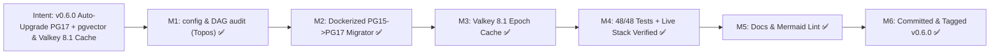
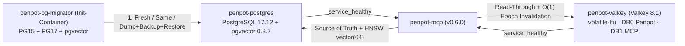
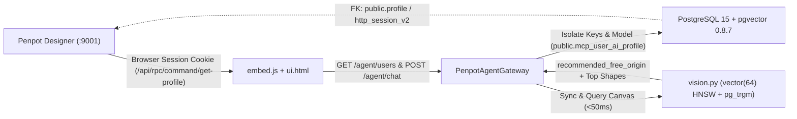
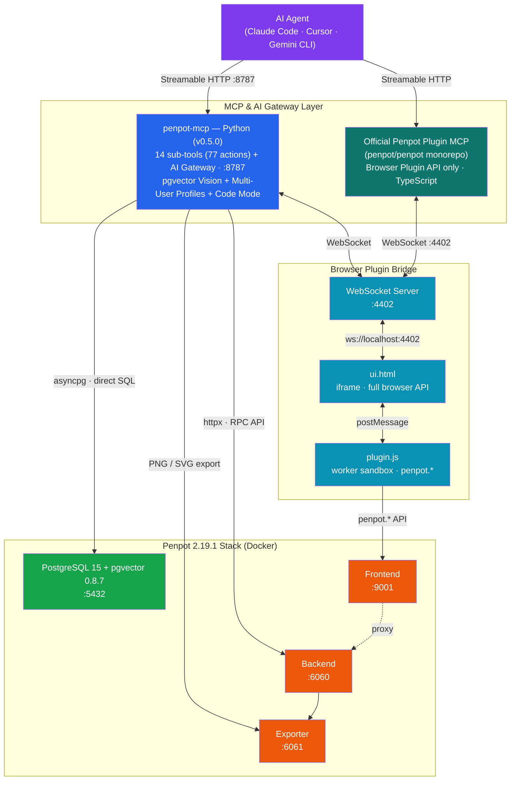

# Penpot MCP Server

**AI-powered design tool access for self-hosted Penpot via Model Context Protocol.**

[](LICENSE)
[](https://python.org)
[](https://go.dev)
[](https://react.dev)
[](https://modelcontextprotocol.io)
[](pyproject.toml)
[](https://penpot.app)
[](https://github.com/pgvector/pgvector)
[](https://valkey.io)
[-orange.svg)](TOOLS.md)

---

## What is this?

An [MCP server](https://modelcontextprotocol.io) that gives AI agents (like Claude Code, Cursor, or any MCP-compatible client) **full programmatic access** to your self-hosted [Penpot](https://penpot.app) instance. AI can read, create, modify, and export design elements — from rectangles and text to full UI components — all through natural language.

Think of it as the bridge between your AI assistant and your design tool.

### Problems it solves

| Problem | Solution |
|---|---|
| **Manual design work** | AI creates UI components, layouts, and prototypes directly in Penpot |
| **No programmatic API for Penpot** | 14 polymorphic domain sub-tools multiplexing all 77 Penpot actions (or 77 individual tools in legacy mode) |
| **Token bloat & multi-turn latency** | AEP-style tool compression (~82% schema reduction) + `playbook_run` Code Mode batching with `$prev`/`$steps`/`$cache` variable piping |
| **Design-to-code gap** | Generate CSS from any shape, export to SVG/PNG, extract design tokens |
| **Repetitive tasks** | Batch operations — rename shapes, update colors, create variants in a single turn |
| **Design system maintenance** | Read/write components, colors, typographies programmatically |

---

## Chat Workspace, Sandboxes, Canvas Delta & Seeding (v0.7.0+)

- **Multi-Day Chat & Sandbox Persistence (`public.mcp_chat_sessions`)**: Conversations, `last_revn`, `sandbox_persistent` flag, and artifact metadata persist in PostgreSQL across days and browser reloads via `/agent/chats` and `/agent/chats/{session_id}` (with `+ Nuevo Chat` and session selector in the React 19 UI).
- **Fresh-Start Database Seeding (`src/penpot_mcp/services/db.py` `ensure_schema`)**: Automatically creates `mcp_user_ai_profile`, `mcp_user_ai_secrets`, `mcp_canvas_vision_index` (HNSW), and `mcp_chat_sessions`, seeds the `'default'` (`Sesión principal`) chat session, and backfills `mcp_user_ai_profile` rows from `public.profile` idempotently (`ON CONFLICT DO NOTHING`).
- **Ephemeral vs. Persistent Sandboxes & Artifact Downloads (`src/penpot_mcp/services/sandbox_sessions.py`)**: Per-chat sandbox policy in Valkey + PostgreSQL (`TTL=SANDBOX_EPHEMERAL_TTL_SEC` by default, or pinned without expiration for long sessions) backed by the `penpot_sandbox_data:/sandbox` Docker volume and `GET /agent/sandbox/download?path=...`.
- **Chat Context Attachments & `.penpot` Template Import (`src/penpot_mcp/services/attachments.py`)**: Supports `.penpot` archives (with Zip-slip/Zip-bomb guards and optional project import), `.svg`, `.json`, `.md`, `.txt`, `.csv`, `.yaml`, images, and Office/PDF files (`.pdf`, `.docx`, `.xlsx`).
- **Unified Design & Media Suite (`design_suite_sandbox` + `ffmpeg` Code Mode)**: Exposes token-efficient Code Mode / sandboxed tools for Pillow, CairoSVG/SVGO, ImageMagick, Inkscape, Ghostscript, Poppler, Tesseract, `pypdf`/`python-docx`/`openpyxl`, and FFmpeg.
- **Real-Time Canvas Visibility & Manual-Edit Probe**: Penpot's native `/ws/notifications` (Redis/Valkey Pub/Sub + `file.revn`) renders agent edits live without reloading, while `plugin.js` (`filechange` / `shapechange`) + `db.get_canvas_delta_since` detect manual user edits between turns, invalidate Valkey `vision`/`file` namespaces, and inject `MANUAL / CANVAS CHANGES SINCE LAST TURN` into the agent prompt.

[⬆ Back to Top](#penpot-mcp-server)

---

## Milestones & Status (v0.6.0)



[⬆ Back to Top](#penpot-mcp-server)

---

## Reproducible PG17 + `pgvector` Auto-Migrator & Valkey 8.1 Cache (v0.6.0)



- **Dockerized Auto-Migrator (`Dockerfile.pg-migrator` + `scripts/pg_migrator.sh`)**: Runs before `penpot-postgres` (`condition: service_completed_successfully`). Detects `PG_VERSION` automatically: passes through on fresh installs, skips on matching versions, and executes `pg_dumpall` → atomic backup → `initdb --data-checksums` → `pg_restore` → `pgvector` + `pg_trgm` + `ANALYZE` (with automatic rollback on failure) on major upgrades (`15 → 17`).
- **Valkey 8.1 Epoch-Namespaced Read-Through Cache (`src/penpot_mcp/services/cache.py` + `config/valkey/valkey.conf`)**: Uses `volatile-lfu` to protect TTL-less `cache:namespace:*:epoch` counters, accelerating repeated `PenpotDB` and `pgvector` Vision reads in DB 1 without touching Penpot's DB 0, and failing open to PostgreSQL if unavailable.

[⬆ Back to Top](#penpot-mcp-server)

---

## Multi-User Penpot Sessions & `pgvector` Canvas Vision Eye (v0.5.0)

`penpot-mcp-server` (`v0.5.0`) connects Penpot's native authentication tables with PostgreSQL `pgvector` so every designer on a self-hosted **Penpot `2.19.1`** team has isolated AI credentials and every LLM in the Gateway has real-time spatial + semantic "eyes" over the canvas:



- **Multi-User Profile Isolation (`public.profile` -> `public.mcp_user_ai_profile`)**: Automatically detects the logged-in Penpot user via `/plugin/embed.js` (or 1-click switching in **Tab `3. Usuarios & pgvector`**) and partitions each designer's active model (`Gemini`, `Claude`, `ChatGPT`, `DeepSeek`, `Ollama`), masked API keys (`…last4`), and custom instructions.
- **`pgvector` Semantic & Spatial Canvas Vision Eye (`src/penpot_mcp/services/vision.py`)**: Auto-enables `vector` (`0.8.7`) and `pg_trgm` (`1.6`) on startup, encodes active page shapes into `vector(64)` HNSW embeddings (`public.mcp_canvas_vision_index`), computes collision-free `recommended_free_origin` coordinates, and injects the live canvas map into every LLM turn — plus the `👁️ Ojos pgvector` quick action and `query_canvas_vision_pgvector` tool.
- **New Endpoints**:
  - `GET | POST /agent/users` — List authenticated Penpot users (`public.profile`) and switch active isolated AI user sessions.
  - `GET | POST /agent/vision` — Sync the active page into `public.mcp_canvas_vision_index` and run hybrid HNSW + `pg_trgm` spatial/semantic queries.

[⬆ Back to Top](#penpot-mcp-server)

---

## In-App Penpot AI Studio & Embedded SDK Agent Pipeline (v0.4.0+)

`penpot-mcp-server` (`v0.4.0`) embeds a modular **SDK Agent Pipeline (`PenpotAgentGateway`)** and an in-app **Penpot AI Studio** mini-frontend (`http://localhost:8787/plugin/ui.html` / `/plugin/manifest.json`):
- **Multi-Provider AI Gateway (`src/penpot_mcp/agent_gateway.py`)**: Native Gemini REST adapter (`gemini-3.5-flash-lite`, `gemini-2.5-flash`) with `thoughtSignature` backfill, OpenAI/Ollama and Anthropic protocol translation, circuit-breaker failover (`primary -> backup -> local -> deterministic`), and 1-turn `playbook_run(action='code')` UI synthesis (`hero_card`, `login_form`, `pricing_card`, `navbar`).
- **Correlated Bidirectional Plugin Bridge (`src/penpot_mcp/ws_controller.py` & `gateway.py`)**: Supports `asyncio.Future` request/response correlation (`execute_script`, `request_context`), same-origin WebSocket (`/plugin/ws` on `:8787`), standalone WebSocket (`:4402`), and HTTP telemetry (`/plugin/telemetry`).
- **REST & WS Endpoints**:
  - `GET /agent/status` — Live provider routing, circuit-breaker status, and active canvas telemetry.
  - `POST /agent/chat` — Natural-language prompt and Quick Action execution directly against the active Penpot canvas.
  - `POST /agent/breakers/reset` — Reset open provider circuit breakers.
  - `WS /plugin/ws` & `POST /plugin/telemetry` — Live bidirectional telemetry and script execution for the Penpot plugin.

---

## Architecture



**Tri-layer access strategy:**
- **Reads** go directly to PostgreSQL via `asyncpg` — fast and reliable, bypasses API overhead
- **Writes** go through Penpot's RPC API via `httpx` — ensures proper change tracking and undo history
- **Exports** use Penpot's built-in exporter (headless Chromium) for pixel-perfect SVG/PNG output
- **Live canvas** goes through the Browser Plugin bridge (port 4402) — shared architecture with the [official Penpot MCP](https://github.com/penpot/penpot/tree/develop/mcp), enabling both servers to coexist and complement each other in the same AI workflow

---

## Tech Stack

| Component | Technology | Purpose |
|---|---|---|
| Language | Python 3.14 + Go 1.24 + TypeScript | MCP/Gateway (`3.14-alpine`), WebSocket Hub (`go 1.24`), React SPA |
| Frontend SPA | [React 19](https://react.dev/) + [Zod](https://zod.dev/) + [Vite](https://vite.dev/) | Runtime schema-validated SPA served via Nginx Unprivileged |
| Reverse Proxy | [Nginx Unprivileged 1.27](https://hub.docker.com/r/nginxinc/nginx-unprivileged) | Single-origin `:8787` gateway, `gzip`, CSP, WS upgrade, immutable assets |
| WebSocket Hub | Go 1.24 (`coder/websocket`) | High-concurrency `/plugin/ws` goroutine hub (`penpot-ws-go:4402`) |
| MCP SDK | [FastMCP](https://github.com/modelcontextprotocol/python-sdk) | Protocol `2025-03-26`, Streamable HTTP & tool registration |
| HTTP / Gateway | [Starlette](https://www.starlette.io/) + [Uvicorn](https://www.uvicorn.org/) | REST endpoints (`/agent/*`, `/plugin/*`) and same-origin WS |
| Vector & DB | [PostgreSQL 15](https://www.postgresql.org/) + [`pgvector 0.8.7`](https://github.com/pgvector/pgvector) + `pg_trgm 1.6` | Penpot data (`public.profile`), isolated AI profiles, and `vector(64)` HNSW Canvas Vision |
| DB Driver | [asyncpg](https://github.com/MagicStack/asyncpg) | High-speed async PostgreSQL & `pgvector` queries |
| HTTP Client | [httpx](https://www.python-httpx.org/) | Penpot RPC API calls & multi-provider LLM Gateway adapters |
| Validation | [Pydantic v2](https://docs.pydantic.dev/) | Automatic parameter validation |
| Package Manager | [uv](https://github.com/astral-sh/uv) | Fast deterministic Python dependency management (`uv.lock`) |
| WebSocket | [websockets](https://websockets.readthedocs.io/) | Real-time bidirectional browser plugin bridge (`:8787` / `:4402`) |
| E2E & QA | [Playwright](https://playwright.dev/) · `pytest` · `ruff` · `mypy` · `semgrep` | Live browser UI/canvas verification & security gates |
| Container | Docker (`penpotapp/*:2.19.1` + `pgvector/pgvector:pg15`) | Self-hosted Penpot + MCP deployment |

[⬆ Back to Top](#penpot-mcp-server)

---

## Quick Start

### Prerequisites

1. **Self-hosted Penpot** running via Docker Compose ([official guide](https://help.penpot.app/technical-guide/getting-started/#install-with-docker))
2. **Docker** and **Docker Compose** v2 installed
3. **Access tokens enabled** in your Penpot instance (see [Enable Access Tokens](#enable-access-tokens))

### Option A: Automated Setup

```bash
git clone https://github.com/ancrz/penpot-mcp-server.git
cd penpot-mcp-server
chmod +x setup.sh
./setup.sh
```

The script will guide you through configuration, build the Docker image, and start the server.

### Option B: Manual Setup

#### 1. Clone the repository

```bash
git clone https://github.com/ancrz/penpot-mcp-server.git
cd penpot-mcp-server
```

#### 2. Create your configuration

```bash
cp .env.example .env
```

Edit `.env` with your Penpot details:

```env
# Your Penpot access token (see "Enable Access Tokens" below)
PENPOT_ACCESS_TOKEN=your-token-here

# Your Penpot database password (from your Penpot docker-compose.yml)
PENPOT_DB_PASS=your-db-password

# Public URL where you access Penpot in the browser
PENPOT_PUBLIC_URL=http://localhost:9001
```

#### 3. Add the MCP service to your Penpot Docker stack

Add the `penpot-mcp` service definition to your existing Penpot `docker-compose.yml`. See [`docker-compose.penpot.yml`](docker-compose.penpot.yml) for the complete service definition to copy.

#### 4. Build and start

```bash
docker compose up -d --build penpot-mcp
```

#### 5. Verify it's running

```bash
# Quick health check
curl -s http://localhost:8787/
# → {"service": "Penpot MCP", "status": "ok", "version": "0.3.0", "tool_mode": "compressed"}
```

```bash
# Full MCP protocol initialization
curl -s http://localhost:8787/mcp \
  -H "Content-Type: application/json" \
  -d '{"jsonrpc":"2.0","id":1,"method":"initialize","params":{"protocolVersion":"2025-03-26","capabilities":{},"clientInfo":{"name":"test","version":"1.0"}}}'
```

You should see a JSON response with the server capabilities.

---

## Connect Your AI Agent

Penpot MCP uses **network transport** (streamable HTTP) — the server runs as a Docker container and clients connect via HTTP. This means:

- The server is **always running** independently (via Docker Compose)
- The client only needs the URL to connect — no process spawning
- **`env` in the client's JSON config is irrelevant** — credentials live in the server's own `.env` file (configured during [setup](#quick-start))
- Any client on the same machine (or network) can connect to `http://localhost:8787/mcp`

> **Key difference from stdio servers:** With stdio servers (like Skill Swarm), the client launches the process and injects env vars. With network servers like Penpot MCP, the server manages its own credentials. The `env` block in your client's MCP config has no effect.

---

### Claude Code

Claude Code uses `"type": "http"` for streamable HTTP connections.

**Global** (`~/.claude.json`):

```json
{
  "mcpServers": {
    "penpot": {
      "type": "http",
      "url": "http://localhost:8787/mcp"
    }
  }
}
```

**Project-level** (`.mcp.json` in your project root):

```json
{
  "mcpServers": {
    "penpot": {
      "type": "http",
      "url": "http://localhost:8787/mcp"
    }
  }
}
```

Restart Claude Code. You should see **14 compressed sub-tools** (default `MCP_TOOL_MODE=compressed`, multiplexing all 77 actions) or **77 tools** (`MCP_TOOL_MODE=legacy`) from the `penpot` server listed when you run `/mcp`.

> **Note:** Use `"type": "http"`, not `"streamable-http"`. Claude Code maps `http` to the streamable HTTP transport internally. Using `streamable-http` will cause a schema validation error.

---

### Gemini CLI

Gemini CLI uses `httpUrl` (not `url`) for streamable HTTP connections. Transport is inferred from the field name.

**Config file:** `~/.gemini/settings.json`

```json
{
  "mcpServers": {
    "penpot": {
      "httpUrl": "http://localhost:8787/mcp"
    }
  }
}
```

> **Note:** Gemini CLI distinguishes between `url` (SSE transport) and `httpUrl` (streamable HTTP transport). Penpot MCP uses streamable HTTP, so use `httpUrl`. No `type` field needed.

---

### Antigravity

Antigravity uses `serverUrl` for HTTP-based MCP servers.

**Config file:** `~/.gemini/antigravity/mcp_config.json`

```json
{
  "mcpServers": {
    "penpot": {
      "serverUrl": "http://localhost:8787/mcp"
    }
  }
}
```

> **Note:** Antigravity uses `serverUrl` (not `url` or `httpUrl`). If Antigravity runs inside Docker, make sure it can reach `localhost:8787` on the host — you may need `host.docker.internal:8787` instead of `localhost:8787` depending on your Docker network setup.

---

### Quick Comparison

| | Claude Code | Gemini CLI | Antigravity |
|---|---|---|---|
| **Config file** | `~/.claude.json` or `.mcp.json` | `~/.gemini/settings.json` | `~/.gemini/antigravity/mcp_config.json` |
| **URL field** | `"url"` | `"httpUrl"` | `"serverUrl"` |
| **Type field** | `"type": "http"` (required) | Not needed (inferred) | Not needed (inferred) |
| **`env` in JSON** | No effect (network server) | No effect (network server) | No effect (network server) |
| **Credentials** | Server's `.env` file | Server's `.env` file | Server's `.env` file |
| **Docker networking** | `localhost:8787` | `localhost:8787` | May need `host.docker.internal:8787` |

---

### Example prompts

Once connected, you can ask your AI agent things like:

- *"List my Penpot projects"*
- *"Create a login form with email/password fields and a submit button"*
- *"Export the Login Card frame as SVG"*
- *"What colors are defined in the design system?"*
- *"Add a comment at position (100, 200) saying 'Review this layout'"*

---

## Interactive Mode: Browser Plugin

The Penpot MCP Plugin bridges the AI agent with the **live Penpot canvas**, enabling real-time context awareness:

- **Live selection**: AI can query which shapes you currently have selected
- **Script execution**: AI can run JavaScript directly via the Penpot Plugin API

> These features require the browser plugin to be connected. The 75 headless tools work without it.

### Loading the Plugin

1. Make sure the MCP server is running: `docker compose up -d penpot-mcp`
2. Open Penpot in your browser
3. Press **Ctrl+Alt+P** (or Main Menu -> Plugin Manager)
4. Paste the URL in the input field: `http://localhost:8787/plugin/manifest.json`
5. Click **Install** → **Allow** on the permissions dialog
6. Click **Open** to launch the plugin panel

The plugin panel appears on the right. When the status indicator turns green, the AI agent has live access to the canvas.

### Penpot Flags Requirement

The Penpot backend must have `enable-plugins-runtime` in `PENPOT_FLAGS`:

```env
PENPOT_FLAGS=enable-login-with-password enable-registration enable-access-tokens enable-plugins-runtime
```

> **Restart required:** After adding `enable-plugins-runtime`, restart both `penpot-backend` and `penpot-frontend`:
> ```bash
> docker compose restart penpot-backend penpot-frontend
> ```

### Browser Compatibility

| Browser | Status | Notes |
|---------|--------|-------|
| **Firefox** | Works out of the box | No local network restrictions |
| **Chrome / Chromium** | Requires one-time approval | See below |
| **Brave** | Requires Shield disabled | See below |
| **Vivaldi** | Requires one-time approval | Same as Chrome |

#### Chrome / Vivaldi: Local Network Access

Chrome may show a permission popup: **"Allow [localhost:9001] to access your local network?"**

1. Click **Allow** when the popup appears
2. The plugin will connect automatically

If no popup appears and the plugin stays disconnected, check `chrome://flags/#private-network-access-respect-preflight-results` -- disable it for local development.

#### Brave: Shield

1. Click the **Shield icon** (lion) in the address bar
2. Disable the Shield for `localhost:9001` (or set to "No Blocking")
3. Reload the Penpot tab and reconnect the plugin

---

## Tools Overview & AEP Code Mode

By default (`MCP_TOOL_MODE=compressed`), the server exposes **14 polymorphic domain sub-tools** inspired by the **Agent Execution Plane (AEP)** architecture. These 14 sub-tools multiplex all **77 Penpot actions** behind a single `action` discriminator per domain, reducing initial MCP `tools/list` schema token overhead by **~82%** while adding:

- **`discover`**: Single-call capability matrix (`action="capabilities"`), intent routing (`action="discover"`), on-demand schema inspection (`action="schema"`), and multi-step workflow recipes (`action="playbook"`), backed by a RAM `SessionPool` (~95% token savings on cache hits).
- **`playbook_run` (Code Mode / Batch Execution)**: Execute multi-step Penpot pipelines in a **single MCP round-trip** (`action="batch"` or `action="code"`) with:
  - **Topos DAG validation** (`ToposGuard`) to block circular step dependencies before execution.
  - **Structural variable hydration** (`${var}` preserving native `int`/`float`/`bool`/`list` types).
  - **Cross-step output piping** (`$prev.shape_id`, `$steps.<step_id>.shape_id`, `$cache.<slot>.id`) so you can create a frame, configure Flex/Grid layout, and insert child shapes in one call without waiting for intermediate UUIDs.
  - **Token optimization controls**: `verbosity="summary" | "detail" | "brief" | "terse"`, `select_fields=["status", "output.shape_id"]` (server-side dot-path field projection), and `return_only="last" | "summary" | "all"`.
- **Configurable Tool Surface (`MCP_TOOL_MODE`)**:
  - `compressed` *(default)*: **14 polymorphic sub-tools** multiplexing all 77 actions.
  - `legacy`: **77 individual tools** for backwards compatibility with legacy prompts.
  - `hybrid`: **91 tools** (both the 14 compressed sub-tools and the 77 legacy tools).

See [**TOOLS.md**](TOOLS.md) for the complete reference of both the **14 compressed sub-tools** and all **77 underlying actions**.

### The 14 Polymorphic Sub-Tools (`MCP_TOOL_MODE=compressed`)

| Sub-Tool | Actions Multiplexed | Domain Summary |
|---|---|---|
| `discover` | 4 (`capabilities`, `discover`, `schema`, `playbook`) | Capability router, schema inspector, and workflow recipes |
| `projects` | 5 (`list_teams`, `list_projects`, `create_project`, `list_files`, `search_files`) | Teams, projects, and project file discovery |
| `files` | 12 (`summary`, `pages`, `history`, `libraries`, `raw_data`, `compare_revisions`, `create`, `rename`, `delete`, `duplicate`, `create_page`, `delete_page`) | File & page CRUD, revision comparison, and raw transit inspection |
| `shapes` | 6 (`tree`, `details`, `css`, `svg`, `layout`, `search`) | Shape hierarchy reading, search, and CSS/SVG/layout extraction |
| `create` | 9 (`rectangle`, `ellipse`, `frame`, `text`, `path`, `group`, `clone`, `component_instance`, `from_svg`) | Shape, frame, vector, SVG, and component instance creation |
| `modify` | 12 (`move`, `resize`, `fill`, `stroke`, `opacity`, `rotation`, `shadow`, `blur`, `border_radius`, `layout`, `delete`, `rename`) | Visual styling, geometry transforms, and Flex/Grid auto-layout |
| `text` | 5 (`get`, `set_content`, `set_font`, `set_font_size`, `set_align`) | Typography and text content manipulation |
| `assets` | 12 (`components`, `colors`, `typographies`, `create_component`, `create_color`, `update_color`, `delete_color`, `create_typography`, `update_typography`, `delete_typography`, `apply_token`, `auto_bind_tokens`) | Design system components, colors, typographies, and design tokens |
| `comments` | 6 (`list_threads`, `thread_comments`, `create`, `reply`, `resolve`, `delete_thread`) | Design review threads and collaboration comments |
| `media` | 3 (`list_media`, `upload`, `list_fonts`) | SSRF-guarded media asset upload and custom fonts |
| `export` | 2 (`png`, `svg`) | Headless Chromium pixel-perfect PNG and vector SVG rendering |
| `system` | 5 (`query_db`, `profile`, `webhooks`, `snapshots`, `create_snapshot`) | Read-only SQL analytics, user profile, webhooks, and snapshots |
| `plugin` | 2 (`selection`, `execute_script`) | Live browser canvas bridge (selection & JS execution) |
| `playbook_run` | 6 (`batch`, `code`, `run`, `create`, `list`, `dag_audit`) | Multi-step Code Mode batch execution with `$prev`/`$steps`/`$cache` piping |

---

## Configuration Reference

All settings are via environment variables. See [`.env.example`](.env.example) for a template.

| Variable | Default | Description |
|---|---|---|
| `PENPOT_MCP_VERSION` | `0.3.0` | Penpot MCP server release version |
| `PYTHON_IMAGE_TAG` | `3.13-alpine` | Base container image tag for Python runtime (`3.13-alpine` or `3.13-slim`) |
| `UV_VERSION` | `0.12.10` | Astral uv version used in container builder stage |
| `MCP_PROTOCOL_VERSION` | `2025-03-26` | Model Context Protocol version header |
| `MCP_TOOL_MODE` | `compressed` | Tool registration mode: `compressed` (14 sub-tools), `legacy` (77 tools), or `hybrid` (91 tools) |
| `PENPOT_BASE_URL` | `http://penpot-frontend:8080` | Internal Penpot URL (Docker network) |
| `PENPOT_PUBLIC_URL` | `http://localhost:9001` | Public URL where you access Penpot in browser |
| `PENPOT_ACCESS_TOKEN` | — | API access token (preferred auth method) |
| `PENPOT_EMAIL` | — | Penpot login email (fallback auth) |
| `PENPOT_PASSWORD` | — | Penpot login password (fallback auth) |
| `PENPOT_DB_HOST` | `penpot-postgres` | PostgreSQL host |
| `PENPOT_DB_PORT` | `5432` | PostgreSQL port |
| `PENPOT_DB_NAME` | `penpot` | Database name |
| `PENPOT_DB_USER` | `penpot` | Database user (`penpot` default for compatibility; dedicated read-only `penpot_mcp` role recommended in production) |
| `PENPOT_DB_PASS` | — | Database password |
| `DB_STATEMENT_TIMEOUT_MS` | `30000` | Read-only SQL statement timeout in milliseconds |
| `SSRF_ALLOW_PRIVATE_MEDIA` | `false` | Allow RFC1918 private network URLs in `upload_media` (loopback & cloud metadata IPs remain always blocked) |
| `MCP_HOST` | `0.0.0.0` | MCP server bind address (publish on `127.0.0.1` only unless behind an authenticating reverse proxy) |
| `MCP_PORT` | `8787` | MCP server port |
| `MCP_LOG_LEVEL` | `info` | Log level (debug/info/warning/error) |
| `MCP_ALLOWED_HOSTS` | `["127.0.0.1","localhost","penpot-mcp"]` | Allowed `Host` headers for DNS-rebinding protection |
| `WS_ENABLED` | `false` | Opt-in toggle for the live browser plugin WebSocket bridge |
| `WS_HOST` | `127.0.0.1` | WebSocket server bind address |
| `WS_PORT` | `4402` | WebSocket port for browser plugin |
| `WS_TOKEN` | — | Shared secret token required to authenticate WebSocket plugin connections |
| `PLUGIN_WS_URL` | `ws://localhost:4402` | WebSocket URL the browser plugin uses to connect |
| `PLUGIN_ORIGIN` | `http://localhost:8787` | Allowed browser `Origin` for the WebSocket handshake |

---

## Enable Access Tokens

Penpot requires a feature flag to enable API access tokens.

### 1. Update your Penpot `.env` file

Add `enable-access-tokens` to your `PENPOT_FLAGS`:

```env
PENPOT_FLAGS=enable-login-with-password enable-registration enable-access-tokens
```

### 2. Restart Penpot

```bash
docker compose restart penpot-backend penpot-frontend
```

### 3. Create a token

1. Open Penpot in your browser
2. Click your avatar (bottom-left) → **Access Tokens**
3. Click **"Generate new token"**
4. Give it a name (e.g., "MCP Server")
5. Copy the token and paste it into your `.env` as `PENPOT_ACCESS_TOKEN`

---

## Penpot Docker Integration

The MCP server runs as a Docker container alongside your existing Penpot stack. You need to add it to your Penpot `docker-compose.yml`.

See [`docker-compose.penpot.yml`](docker-compose.penpot.yml) for the exact service definition to add. The key points:

- It connects to the `penpot` Docker network (same as other Penpot services)
- It depends on `penpot-postgres` (with health check) and `penpot-backend`
- It exposes port `8787` on localhost only (`127.0.0.1:8787:8787`)
- Environment variables reference Docker internal hostnames

---

## Development

### Running locally (outside Docker)

```bash
# Install uv if needed
curl -LsSf https://astral.sh/uv/install.sh | sh

# Install dependencies
uv sync

# Run the server (needs .env configured for local access)
uv run penpot-mcp
```

For local development, point `PENPOT_DB_HOST` and `PENPOT_DB_PORT` to your host-mapped PostgreSQL port, and `PENPOT_BASE_URL` to `http://localhost:9001`.

### Running tests

```bash
uv sync --group dev
uv run pytest tests/ -v
```

### Project structure

```
penpot-mcp-server/
├── src/penpot_mcp/
│   ├── __init__.py          # Package version (__version__ = "0.3.0")
│   ├── server.py            # FastMCP entry point, 14 compressed / 77 legacy tool modes
│   ├── aep_engine.py        # AEP RAM SessionPool, ToposGuard DAG, field projection & piping
│   ├── config.py            # Pydantic Settings configuration
│   ├── gateway.py           # Hybrid context gateway (DB + Plugin awareness)
│   ├── ws_controller.py     # WebSocket server for browser plugin bridge (:4402)
│   ├── plugin/
│   │   ├── manifest.json    # Penpot plugin manifest (served at /plugin/manifest.json)
│   │   ├── plugin.js        # Plugin worker — penpot.* API only (no WebSocket in sandbox)
│   │   └── ui.html          # Plugin iframe — WebSocket lives here, relays to plugin.js
│   ├── services/
│   │   ├── db.py            # asyncpg connection pool (read-only SQL guards)
│   │   ├── api.py           # httpx RPC API client + SSRF & RPC command guards
│   │   ├── changes.py       # Penpot change operations builder
│   │   └── transit.py       # Transit+JSON decoder
│   ├── tools/
│   │   ├── subtools.py      # 14 polymorphic domain sub-tools + playbook_run Code Mode
│   │   ├── projects.py      # Team & project queries
│   │   ├── files.py         # File CRUD operations
│   │   ├── shapes.py        # Shape reading & search
│   │   ├── create.py        # Shape creation
│   │   ├── modify.py        # Shape modification
│   │   ├── text.py          # Text operations
│   │   ├── export.py        # PNG/SVG export
│   │   ├── components.py    # Components & shared libraries
│   │   ├── colors.py        # Library color assets (solid & gradient)
│   │   ├── typographies.py  # Library typography assets
│   │   ├── tokens.py        # Design tokens & auto-binding
│   │   ├── comments.py      # Comments & collaboration
│   │   ├── media.py         # Media assets & fonts (SSRF-guarded)
│   │   ├── database.py      # Read-only SQL queries
│   │   └── advanced.py      # File raw data & revision comparison
│   └── transformers/
│       ├── css.py           # Shape → CSS conversion
│       ├── svg.py           # Shape → SVG conversion
│       └── layout.py        # Layout → CSS flexbox/grid
├── tests/
│   ├── conftest.py
│   ├── test_projects.py
│   ├── test_files.py
│   ├── test_shapes.py
│   └── test_e2e_login_form.py
├── pyproject.toml
├── Dockerfile
├── .env.example
├── setup.sh
├── docker-compose.penpot.yml
├── TOOLS.md
└── LICENSE
```

---

## License

This project is licensed under the [Apache License 2.0](LICENSE).

---

## Acknowledgments

- [Penpot](https://penpot.app) — The open-source design platform
- [Model Context Protocol](https://modelcontextprotocol.io) — The protocol standard
- [FastMCP](https://github.com/modelcontextprotocol/python-sdk) — Python MCP SDK

<div align="center">

[⬆ Back to Top](#penpot-mcp-server)

</div>
