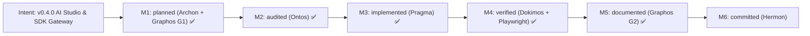

# Project Milestones

## Intent: v0.4.0 Hybrid PenpotGateway + SDK Agent Pipeline + In-App Penpot AI Studio GUI

### Milestone Breakdown

| Milestone | Agent | Status | Target / Artifact |
|---|---|---|---|
| **M1: RE as SDD Blueprint & Plan** | Archon + Graphos G1 | Completed (✅) | `docs/06_re_sdd_ai_gateway_blueprint.md`, `_re/figma_ai_penpot_sdd/blueprint.md` |
| **M2: Structural & DAG Audit** | Ontos (Stage 3) | Completed (✅) | `docs/pipeline/feature_20261113_223500.md` (APPROVED, 0 co-dependencies) |
| **M3: Gateway, SDK Pipeline & GUI** | Pragma (Stage 4) | Completed (✅) | `docs/pipeline/execution_report.md` (`gateway.py`, `ws_controller.py`, `agent_gateway.py`, `ui.html`, `plugin.js`) |
| **M4: Live Stack + Playwright E2E** | Dokimos (Stage 5) | Completed (✅) | `docs/pipeline/verification_report.md` (45 unit tests, 0 CVEs, live Gemini + Playwright verified) |
| **M5: Documentation & State Rollup** | Graphos (Stage 2 - G2) | Completed (✅) | `docs/COMPACT.md`, `README.md`, `README.es-ES.md`, `TOOLS.md` |
| **M6: Atomic Commit & Push (`dev`)** | Hermon (Stage 6) | Ready (⏳) | Conventional Commit on `dev` (`v0.4.0`) |
