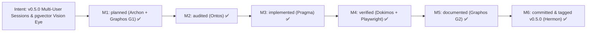

# Project Milestones

## Intent: v0.5.0 Multi-User Penpot Profile Isolation & PostgreSQL `pgvector` Canvas Vision Eye

### Milestone Breakdown (`v0.5.0`)

| Milestone | Agent | Status | Target / Artifact |
|---|---|---|---|
| **M1: Architecture & Schema Plan** | Archon + Graphos G1 | Completed (✅) | `scripts/init_pgvector_and_users.sql`, `docs/PROJECT.md` |
| **M2: Structural & DAG Audit** | Ontos (Stage 3) | Completed (✅) | AEP `topos_audit_dag` (`APPROVED`, 0 co-dependencies) |
| **M3: `pgvector` Vision + Multi-User Gateway** | Pragma (Stage 4) | Completed (✅) | `vision.py`, `db.py`, `agent_gateway.py`, `server.py`, `ui.html` |
| **M4: Live Stack + Playwright E2E** | Dokimos (Stage 5) | Completed (✅) | `47` unit tests, Ruff/Mypy/Semgrep `0` issues, `35` shapes indexed in `pgvector 0.8.7` |
| **M5: Documentation & Mermaid Lint** | Graphos (Stage 2 - G2) | Completed (✅) | `README.md`, `README.es-ES.md`, `docs/PROJECT.md`, `docs/MILESTONES.md`, `docs/COMPACT.md` |
| **M6: Atomic Commit, Tag `v0.5.0` & Push** | Hermon (Stage 6) | Completed (✅) | Commit `6281248` on `dev` & `main`, tag `v0.5.0` |
