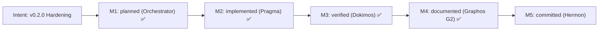

# Project Milestones

## Intent: v0.2.0 Hardening & Security Remediation

### Milestone Breakdown

| Milestone | Agent | Status | Target / Artifact |
|---|---|---|---|
| **M1: Inline Plan** | Orchestrator (Short Mode) | Completed (✅) | Architecture & Task definition |
| **M2: Execution & Hardening** | Pragma (Stage 4) | Completed (✅) | `docs/pipeline/execution_report.md` |
| **M3: Verification Gates (Initial)** | Dokimos (Stage 5) | Remediated (✅) | Defect Ruff F841 caught & isolated |
| **M4: Loop 1 Fix Execution** | Pragma (Stage 4 - Loop 1) | Completed (✅) | Removed unused variable `timeout_param`, rebuilt image |
| **M5: Final Verification** | Dokimos (Stage 5 - Loop 1) | Completed (✅) | `docs/pipeline/verification_report.md` (VERIFIED: 8/8 gates PASS) |
| **M6: State Recording & Rollup** | Graphos (Stage 2 - G2) | Completed (✅) | `docs/COMPACT.md`, `feature_20261113_172000.md` |
| **M7: Version Control Commit & Tag** | Hermon (Stage 6) | Ready (⏳) | Atomic commit & release tag `v0.2.0` |
