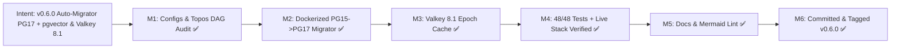

# Project Milestones

## Intent: v0.6.0 Reproducible PG17 + `pgvector` Auto-Migrator & Valkey 8.1 Read-Through Cache

### Milestone Breakdown (`v0.6.0`)

| Milestone | Agent | Status | Target / Artifact |
|---|---|---|---|
| **M1: Tuned Configs & DAG Audit** | Orchestrator + AEP `topos_audit_dag` | Completed (✅) | `config/postgresql/postgresql.conf`, `config/valkey/valkey.conf`, `APPROVED` (0 co-deps) |
| **M2: Dockerized PG Auto-Migrator** | Pragma (Short) | Completed (✅) | `Dockerfile.pg-migrator`, `scripts/pg_migrator.sh`, `docker-compose.penpot.yml` |
| **M3: Valkey 8.1 Epoch Cache** | Pragma (Short) | Completed (✅) | `src/penpot_mcp/services/cache.py`, `db.py`, `agent_gateway.py`, `config.py` |
| **M4: Sandbox & Live Verification** | AEP `sandbox_run` + Semgrep + Live Docker | Completed (✅) | `48` passed, `0` Ruff/Mypy/Semgrep, live PG `17.12` + `pgvector 0.8.7` + Valkey `8.1` |
| **M5: Docs & Mermaid Lint** | Graphos (G2) | Completed (✅) | `README.md`, `README.es-ES.md`, `docs/MILESTONES.md`, `docs/COMPACT.md` (`mmdc` 10/10 PASS) |
| **M6: Atomic Commit, Tag `v0.6.0` & Push** | Hermon (Stage 6) | Completed (✅) | Commit & annotated tag `v0.6.0` on `dev` & `main` |
