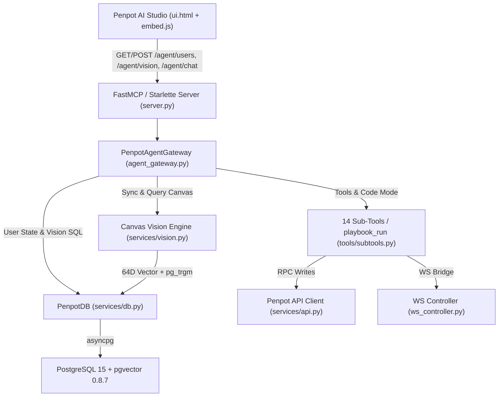

# Project Context: Penpot MCP Server

## 1. Premise & Core Intent
`penpot-mcp-server` (`v0.5.0`) provides AI agents (Claude Code, Cursor, Gemini CLI, Antigravity) and in-app Penpot designers with full programmatic access to self-hosted [Penpot](https://penpot.app) (`2.19.1`) via the Model Context Protocol (FastMCP `2025-03-26`), an AEP-inspired **14 Sub-Tool + Code Mode (`playbook_run`)** execution engine, an embedded **SDK Agent Pipeline (`PenpotAgentGateway`)**, **Multi-User Penpot Profile Isolation**, and a **PostgreSQL `pgvector` Semantic & Spatial Canvas Vision Eye**.

## 2. Active Intent: v0.5.0 Multi-User Penpot Sessions & `pgvector` Canvas Vision Eye
- **Multi-User Penpot Profile Isolation (`public.profile` + `public.http_session_v2` + `public.presence` -> `public.mcp_user_ai_profile`)**:
  - Automatically detects the logged-in Penpot user via `/plugin/embed.js` (`/api/rpc/command/get-profile`) or session resolution, isolating each designer's `active_profile`, masked provider API keys (`…last4`), and `agent_instructions` in PostgreSQL without interrupting teammates working on the same project.
- **PostgreSQL `pgvector` Canvas Vision Eye (`src/penpot_mcp/services/vision.py` -> `public.mcp_canvas_vision_index`)**:
  - Runs on `pgvector/pgvector:pg15` (PostgreSQL `15` + `pgvector 0.8.7` + `pg_trgm 1.6`) with auto-initialization on `PenpotDB.connect()`.
  - Encodes every shape on the active Penpot page into a normalized 64D vector (`vector(64)` HNSW cosine index + `pg_trgm`), computes `recommended_free_origin` for collision-free placement, and injects the semantic + spatial canvas map into every Gateway LLM turn.
- **In-App Penpot AI Studio (`ui.html`)**:
  - Added user badge (`👤 Anthony Cruz`), `👁️ pgvector` badge, `👁️ Ojos pgvector` quick action, and **Tab 3 (`3. Usuarios & pgvector`)** inside `⚙️ Config` for 1-click user switching and live semantic canvas scanning.

## 3. Dependency & Reinforcement Topology

## 4. Current State
- **Release**: `v0.5.0` tagged and pushed on `dev` and `main`.
- **Verification**: `47 passed` in `pytest`, `0` Ruff/Mypy issues across 34 source files, `0` Semgrep findings, `topos_audit_dag` **APPROVED** (`0` co-dependencies), live `penpot-mcp:0.5.0` running on `:8787` indexing `35` canvas shapes in `<50ms`, and Playwright E2E screenshots verified.
