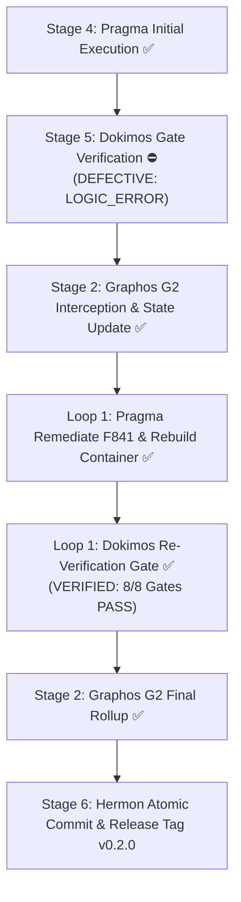

# Pipeline State Artifact: v0.2.0 Hardening & Verification Rollup

**Artifact ID:** `feature_20261113_172000`  
**Chain Predecessor:** None (Root document for v0.2.0 upgrade chain)  
**Pipeline Mode:** Short Mode  
**Timestamp:** 2026-11-13T21:30:00Z  
**Branch:** `dev`  
**Target:** `penpot-mcp:0.2.0`  
**Final Verdict:** **VERIFIED**  

---

## 1. Operating Premises & Blast Radius (P1)

- **Tool Reach & Chosen Path:**
  - Standard/direct engineering path within repository workspace.
  - Tools utilized: `uv` package manager, Python 3.13 virtual environment, Docker engine (`docker build`, `docker scout`), static analysis suite (`pytest`, `ruff`, `mypy`, `semgrep`, `pip-audit`).
- **Verified Blast Radius:**
  - 14 project files modified within declared scope:
    - `pyproject.toml`, `uv.lock`
    - `Dockerfile`, `docker-compose.penpot.yml`, `setup.sh`
    - `.env.example`, `.env.local.example`, `.env`
    - `src/penpot_mcp/config.py`, `src/penpot_mcp/services/api.py`, `src/penpot_mcp/services/db.py`, `src/penpot_mcp/tools/tokens.py`, `src/penpot_mcp/ws_controller.py`
    - `tests/test_unit_core.py`
    - User-facing documentation: `README.md`, `README.es-ES.md`
    - Pipeline records: `docs/pipeline/` (`execution_report.md`, `verification_report.md`, `feature_20261113_172000.md`)
  - Dokimos structural audit confirmed zero out-of-scope modifications.

---

## 2. Quality Gate Verification Matrix (Final)

Dokimos (Stage 5) confirmed **VERIFIED** across all 8 independent gates:

| Layer / Gate | Command / Target | Status | Output / Findings |
|---|---|---|---|
| **Unit & Regression Suite** | `.venv/bin/pytest -v` | **PASS** | 38 passed, 15 deselected (integration) |
| **Type Checking** | `.venv/bin/mypy src/penpot_mcp/...` | **PASS** | Success: 0 issues across 7 files |
| **Linter & Static Analysis** | `.venv/bin/ruff check src/ tests/` | **PASS** | All checks passed! (0 errors, F841 resolved) |
| **SAST (Auto Pack)** | `semgrep scan --config auto --error .` | **PASS** | 1584 rules evaluated: **0 findings** |
| **SAST (Security Suite)** | `semgrep scan --config p/dockerfile ... --error .` | **PASS** | 1455 rules evaluated: **0 findings** |
| **Python Supply Chain** | `pip-audit` | **PASS** | **0 known vulnerabilities** (down from 76 CVEs) |
| **Container Smoke Test** | `docker run --rm penpot-mcp:0.2.0 ...` | **PASS** | `OK 0.2.0` (non-root `appuser`) |
| **Container SBOM & OSV** | `docker scout sbom` + OSV batch query | **PASS** | 78 container artifacts: **0 CVEs** (down from 39) |

---

## 3. Remediation History (Loop 1)

- **Initial Failure:** Ruff `F841` flagged unused local variable `timeout_param` at `src/penpot_mcp/services/db.py:49:17`.
- **Pragma Remediation:** Removed unused variable and rebuilt Docker container image `penpot-mcp:0.2.0`.
- **Re-Verification:** Dokimos confirmed clean pass across all 8 gates.

---

## 4. State Evolution Diagram

---

## 5. Handoff to Hermon (Stage 6)

- **Status:** All quality gates verified green; pipeline state fully synchronized.
- **Action:** Transition control to Orchestrator to invoke Hermon for atomic commit creation (Conventional Commits v1.0.0) and git release tag `v0.2.0`.
