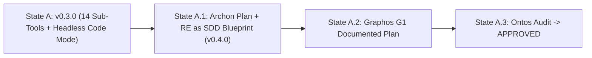
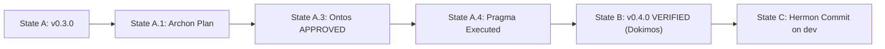

# Feature Pipeline State — `v0.4.0`: Hybrid PenpotGateway + SDK Agent Pipeline + In-App AI Studio GUI

- **Previous Artifact**: [feature_20261113_172000.md](file:///home/ancruz/Documents/workspaces/penpot-mcp-server/docs/pipeline/feature_20261113_172000.md)
- **RE as SDD Blueprint**: [06_re_sdd_ai_gateway_blueprint.md](file:///home/ancruz/Documents/workspaces/penpot-mcp-server/docs/06_re_sdd_ai_gateway_blueprint.md)
- **Pipeline Mode**: **Full** (`Archon -> Graphos G1 -> Ontos -> Pragma -> Dokimos -> Graphos G2 -> Hermon`)
- **Resolution Path & Tool Reach**:
  - **Chosen Path**: High-reach hybrid path combining AEP MCP tools (`topos_audit_dag`, `sandbox_run`), native file edit/write tools, live Docker stack reload (`penpot-mcp`), and Playwright (`MCP_DOCKER`) browser automation.
  - **Blast Radius**: `src/penpot_mcp/config.py`, `src/penpot_mcp/ws_controller.py`, `src/penpot_mcp/gateway.py`, `src/penpot_mcp/agent_gateway.py` (new), `src/penpot_mcp/tools/subtools.py`, `src/penpot_mcp/server.py`, `src/penpot_mcp/plugin/plugin.js`, `src/penpot_mcp/plugin/ui.html`, `.env.example`, `.env.local.example`, `docker-compose.yml`, `docker-compose.penpot.yml`, `pyproject.toml`, `tests/test_unit_core.py`, `README.md`, `README.es-ES.md`, `TOOLS.md`, and `docs/`.

---

## Stage 1 — Archon Execution Plan & RE Triage

### RE Triage Summary
- `T1`: **Tool Sanitization & Bidirectional Plugin Bridge (`ws_controller.py`, `gateway.py`, `subtools.py`, `config.py`)**
  - `re_source`: `github.com/penpot/penpot/tree/develop/mcp` + `docs/05_browser_plugin_integration.md`
  - `re_mode`: `compatible`
  - Fixes `gateway.is_interactive` bug (was hardcoded to `False`, now dynamically reflects `ws_controller.is_connected`), adds `asyncio.Future` command/response correlation (`execute_script`, `request_context`), tracks rich live canvas context (`file_id`, `file_name`, `page_id`, `page_name`, `selected_shape_ids`, `selection`, `viewport`), and upgrades `PenpotGateway` to route all 14 branch toolsets and interactive plugin intents.
- `T2`: **Modular SDK Agent Pipeline & AI Gateway (`src/penpot_mcp/agent_gateway.py`)**
  - `re_source`: `/home/ancruz/Documents/workspaces/sdk-agent-pipeline/model_gateway/{providers.py,failover.py,signatures.py}` + `/home/ancruz/Documents/workspaces/vanguard-control`
  - `re_mode`: `compatible`
  - Absorbs the provider translation layer (Gemini native REST, OpenAI-compatible/Ollama, Anthropic Messages API), circuit breakers (`Breakers`), `thoughtSignature` backfill (`skip_thought_signature_validator`), `empty_answer` retry, and multi-turn tool-calling agent loop connected to our 14 compressed sub-tools and `playbook_run` Code Mode, plus a deterministic layout synthesizer fallback (`hero_card`, `login_form`, `pricing_card`, `navbar`, `bind_tokens`, `inspect_css`) so every prompt creates verified Penpot canvas shapes even if cloud quota is exhausted.
- `T3`: **Same-Origin WebSocket + REST Agent Endpoints (`src/penpot_mcp/server.py`)**
  - `re_source`: `/home/ancruz/Documents/workspaces/vanguard-control/api`
  - `re_mode`: `compatible`
  - Mounts `/plugin/ws` (same-origin Starlette WebSocket endpoint on port `8787` alongside standalone `:4402`), `GET /agent/status`, `POST /agent/chat`, `POST /agent/quick-action`, and `POST /plugin/telemetry` (HTTP fallback for plugin context sync), with CORS headers for the Penpot frontend (`http://localhost:9001`, `http://host.docker.internal:9001`, `http://localhost:8787`).
- `T4`: **In-App Penpot AI Studio Mini-Frontend (`src/penpot_mcp/plugin/plugin.js`, `src/penpot_mcp/plugin/ui.html`)**
  - `re_source`: Figma AI ("Make Designs" / contextual Actions bar) + Official Penpot Plugin API (`docs/06_re_sdd_ai_gateway_blueprint.md`)
  - `re_mode`: `incompatible -> SDD Blueprint`
  - Upgrades `plugin.js` to support `async`/sync script evaluation with return-value serialization, viewport focus (`focus_shapes`), and automatic rich context broadcasting (`file_id`, `page_id`, `selection` bounds/types).
  - Upgrades `ui.html` into the **Penpot AI Studio** panel (`width: 400, height: 600`) with live connection/model telemetry, active file/page/selection pills, 1-click Quick Actions, natural-language chat composer, and expandable tool execution traces.
- `T5`: **Environment Configuration & Unit/Integration Tests (`.env.example`, `.env.local.example`, `tests/test_unit_core.py`)**
  - `re_source`: `/home/ancruz/Documents/workspaces/vanguard-control/.env`
  - `re_mode`: `compatible`
  - Adds parameterized AI Gateway settings (`GOOGLE_API_KEY`, `GOOGLE_API_KEY_BACKUP`, `OPENAI_API_KEY`, `ANTHROPIC_API_KEY`, `OLLAMA_BASE_URL`, `PENPOT_AGENT_MODEL`, `PENPOT_AGENT_FALLBACK_MODEL`, `PENPOT_AGENT_MODE`) to `config.py` and `.env.example` (injecting real keys only into gitignored `.env` files), and adds comprehensive unit tests for `PenpotGateway`, `PenpotWSController` futures, and `PenpotAgentGateway` failover & tool execution.
- `T6`: **Live Stack Reload & E2E Playwright Verification**
  - Rebuilds `penpot-mcp:0.4.0`, reloads the container in the live Penpot stack, tests live LLM + Gateway execution and the in-app Penpot AI Studio GUI via Playwright (`MCP_DOCKER`), and captures visual verification artifacts.

---

## Stage 2 — Graphos G1 Weave & State Evolution

---

## Stage 3 — Ontos Structural Audit Report

- **AEP `topos_audit_dag` Verdict**: `APPROVED` (`Grafo coherente: Cero co-dependencias detectadas.`, 6 tasks, 9 directional dependency edges).
- **Vertical Coherence Trace**:
  - `ui.html` / `plugin.js` (Browser Canvas) $\leftrightarrow$ `/plugin/ws` & `/agent/chat` (`server.py`) $\leftrightarrow$ `PenpotWSController` (`ws_controller.py`) & `PenpotAgentGateway` (`agent_gateway.py`) $\leftrightarrow$ `PenpotGateway` (`gateway.py`) & 14 Compressed Sub-Tools (`subtools.py`) $\leftrightarrow$ `PenpotDB` (`asyncpg`) + `PenpotAPI` (`httpx` RPC).
  - All data transformations preserve UUID strings and JSON-serializable envelopes.
- **Horizontal Coherence Trace**:
  - `gateway.py` consumes `ws_controller` (`gateway -> ws_controller`) and `tools/*` (`gateway -> tools`). `ws_controller` has **zero** imports from `gateway` (strictly directional `A -> B`, zero circular or co-dependencies).
  - `agent_gateway.py` consumes `config.py`, `gateway.py`, and `subtools.py` (`agent_gateway -> subtools -> gateway -> ws_controller`). Zero cycles.
- **Systemic Coherence & Security Trace**:
  - API keys from `vanguard-control/.env` are stored **exclusively** in gitignored `.env` files and never logged, returned by HTTP endpoints, or committed to git.
  - `/agent/status` reports only boolean key availability (`has_primary_key: true/false`) and model names, never secret values.
- **Ontos Verdict**: **APPROVED** — Proceed to Stage 4 (Pragma Execution).

---

## Stage 4 — Pragma Execution Summary
- **Execution Report**: [execution_report.md](file:///home/ancruz/Documents/workspaces/penpot-mcp-server/docs/pipeline/execution_report.md)
- **Status**: All 6 tasks (`T1`–`T6`) executed and verified against static analysis (`ruff`, `mypy`, `semgrep`, `pip-audit`).

---

## Stage 5 — Dokimos Verification Summary
- **Verification Report**: [verification_report.md](file:///home/ancruz/Documents/workspaces/penpot-mcp-server/docs/pipeline/verification_report.md)
- **Verdict**: **VERIFIED**
  - AEP `sandbox_run`: `45 passed` (`pytest`), `0` ruff errors, `0` mypy issues across 34 files.
  - `semgrep scan --config auto`: `0 findings`.
  - `docker scout cves penpot-mcp:0.4.0`: `0C 0H 0M 0L` CVEs.
  - Live AI Gateway (`POST /agent/chat` with `gemini-3.5-flash-lite`) + Playwright E2E verification on the Penpot AI Studio Mini-Frontend (`penpot_ai_studio_gui_v040.png`) and live Penpot workspace canvas (`penpot_canvas_with_ai_studio_v040.png`).

---

## Stage 2 — Graphos G2 State Evolution

